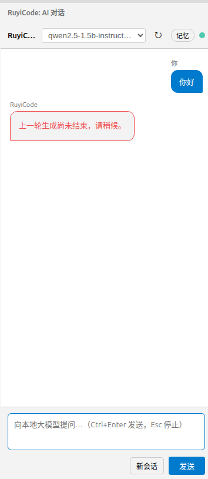
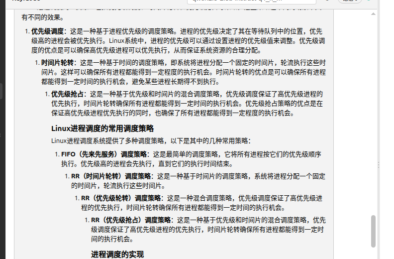
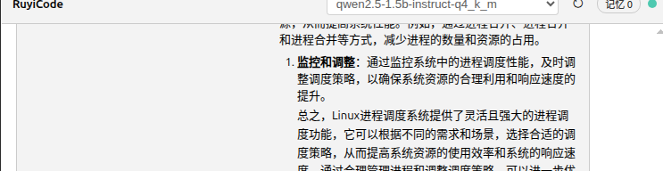
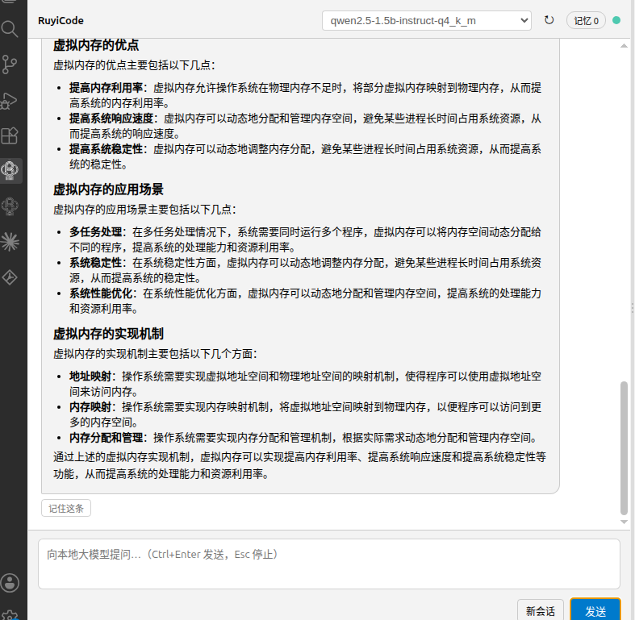
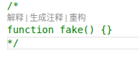

# RuYiCode 0.4.10 插件测试报告

| 项目 | 内容 |
| --- | --- |
| 被测件 | `ruyicode-0.4.10.vsix`（插件标识 `local.ruyi-code`，版本 **0.4.10**） |
| 测试方式 | 在 VS Code 1.138.0 界面上逐条执行《RuYiCode 插件完整测试流程（测试材料 2.0）》第 4 节用例 |
| 测试人 | ＿＿＿＿＿＿ |
| 测试日期 | 2026-10-12 |
| 已确认缺陷 | **5 条**（B1-1、B2-1、B2-2、B2-3、C5） |
| 已实测通过 | 4 条用例（见「五、已实测通过的部分」） |

> 本报告只收录测试人员在实际界面操作中亲自发现并确认的缺陷。
> 缺陷编号沿用发现该问题的测试用例编号（与流程文档的 A1、B1、B2、C5 这套编号一致）。
> 全部缺陷均通过 **VS Code 界面操作 + 设置页 + 真实 llama.cpp 模型** 验证，不使用脚本或伪造请求。

---

## 一、测试环境

| 项目 | 内容 |
| --- | --- |
| 操作系统 | Ubuntu 22.04（VMware 虚拟机） |
| VS Code | 1.138.0（界面语言：简体中文） |
| 推理引擎 | llama.cpp（本地原生 Linux 构建），端口 8080 |
| 模型 | `qwen2.5-1.5b-instruct-q4_k_m.gguf` |
| 其它环境 | 未使用 Ollama；未部署 ruyi-server（源码树在 `/home/chu/ruyi-workspace`） |

**引擎启动命令**（终端中执行，窗口需保持打开）：

```bash
/home/chu/llama.cpp/build/bin/llama-server \
  -m /home/chu/llama.cpp/models/qwen2.5-1.5b-instruct-q4_k_m.gguf \
  -c 4096 --port 8080 \
  --alias qwen2.5-1.5b-instruct-q4_k_m
```

窗口中出现 `listening on http://127.0.0.1:8080` 表示启动成功，按 `Ctrl+C` 停止。

**插件设置**（`Ctrl+,` 搜 RuyiCode；对应 `~/.config/Code/User/settings.json`）：

- Engine Type：`llama-server`
- Endpoint：`http://127.0.0.1:8080/v1`
- Llama.cpp 根目录：`/home/chu/llama.cpp/build`
- llama-server 路径：`/home/chu/llama.cpp/build/bin/llama-server`
- 模型路径：`/home/chu/llama.cpp/models/qwen2.5-1.5b-instruct-q4_k_m.gguf`
- 上下文 / 最大输出：`numCtx = 4096`、`maxTokens = 2048`

**测试入口**：活动栏 RuyiCode 图标 →「AI 对话」面板（快捷键 `Ctrl+Alt+L`）。

> **前置说明**：本插件在冷启动时不会自动加载（该现象已实测复现，列于「六、后续测试计划」中的 **1.2-补**）。因此每次测试前需先点击一次活动栏 RuyiCode 图标，确保 CodeLens、内联补全与命令均已注册，否则会把"未加载"误判为功能缺陷。

---
## 二、缺陷汇总

| 编号 | 严重程度 | 涉及用例 | 问题概述 |
|---|---|---|---|
| **B2-1** | 一般 | B2 | 模型流式输出过程中，**每吐出一个字就把滚动条强制拽回底部**，用户向上滚动回看历史会被反复打断，无法边生成边回看 |
| **B2-2** | 一般 | B2 | **有序列表渲染错乱**：`<ol>` 被 `</ul>` 闭合，浏览器序号计数器重置，**每一条都显示 `1.`**；嵌套列表的缩进也被丢弃，层级被压平 |
| **B2-3** | **严重** | B2 | **代码块误判导致回答大段消失**：缩进在列表项内的 ` ``` ` 被反复当成"新开代码块"，整段回答被误判为代码，标题/列表/正文全部不渲染，界面出现多个空灰框 |
| **B1-1** | **严重** | B1 | **切换视图会清空对话并卡死输入**：生成中切到左侧资源管理器再切回，**已有对话记录全部消失**；此时再发消息被永久拒绝，提示「**上一轮生成尚未结束，请稍候。**」，只能靠重载窗口或新会话恢复 |
| **C5** | 一般 | C5 | **「生成注释」声明识别问题（含 2 个问题）**：① 在 Go/Rust/Java/C++ 等文件里，光标停在函数声明行时，**命令面板报"未识别到可注释的代码"，而函数上方的 CodeLens 却能成功生成注释**；② **注释里的假函数也被当成真声明** —— 块注释内的 `function fake() {}` 上方照样出现「解释/生成注释/重构」入口 |

> **编号说明**：
> - **B2-1 / B2-2 / B2-3** 三条缺陷均对应流程文档 4-B2 用例（"回答逐字流式出现"），故统一归入 **B2** 系列，分别以 `B2-1`、`B2-2`、`B2-3` 区分；在《测试材料2.0-缺陷清单》中分别登记为 **N33**、**N34**、**N35**。
> - **C5** 对应流程文档 4-C5 用例（CodeLens 与代码注释），**含 2 个问题**：问题①为命令入口漏报（清单 **N19**），问题②为 CodeLens 误报（清单 **N19b**）。
> - 本报告采用用例编号以便与流程文档对照。

---
## 三、缺陷详情

### B1-1（严重）切换视图会清空对话内容，并把输入卡死

#### 现象

对话进行中（或生成进行中）把左侧切到**资源管理器**视图，再切回 RuyiCode 对话面板，出现两个问题：

1. **之前的所有问答全部消失**，面板变成空白（只剩刚发出去的那一条用户消息）；
2. 此时再发送消息，**被永久拒绝**，面板弹出红色提示：

> 上一轮生成尚未结束，请稍候。

此后无论怎么重发、等待多久都无效，只能**重新加载窗口**或点「新会话」才能恢复。



#### 复现步骤

1. `Ctrl+Shift+P` → `开发人员: 重新加载窗口` → 点一次活动栏 RuyiCode 图标；
2. `Ctrl+Alt+L` 打开对话面板，先发一两条普通问题，**等回答结束**；
3. 发送一条**会产生较长回答**的问题，例如「请用中文详细写 800 字介绍 TCP 三次握手」；
4. **在它还在逐字生成时**，点左侧活动栏的**资源管理器**图标（把对话面板切走）；
5. 约 3~5 秒后，再点回 **RuyiCode** 图标，回到对话面板；
6. 观察面板里的历史内容；
7. 再随便发一句（例如「你好」），观察提示。

#### 实测结果

| 步骤 | 结果 |
| --- | --- |
| 6 | 之前的问答**全部消失**，面板几乎空白 |
| 7 | 弹出 **「上一轮生成尚未结束，请稍候。」**，之后每次发送都被同样拒绝 |

#### 与文档的对照

流程文档 4-B2 用例要求对话面板能正常多轮对话；README 也说明对话面板可在活动栏随时切换。实测中**切换视图会导致会话内容丢失且输入被锁死**，与预期严重不符。

#### 原因（代码定位）

**问题 1：视图重建时无条件清空会话**

切换活动栏视图会**销毁并重建 Webview**，每次重建都会执行 `resolveWebviewView`：

```js
// media/chat/../features/chatView.js:113-120
this.sessionId = '';          // ← 丢弃当前会话
this.messages = [];           // ← 清空内存中的对话
this.sendInit();
this.restoreSession();        // ← 只有在能找到会话文件时才回灌
```

若 `restoreSession()` 没能取回上一次会话（例如该轮回答尚未写入会话转录，`latestSessionId()` 取到了别的文件或取不到），**面板就变成空白**，用户看到的历史随之消失。

**问题 2：`isStreaming` 状态未复位，输入被永久锁死**

发送消息前有一道守卫：

```js
// out/features/chatView.js:258-261
if (this.isStreaming) {
    this.send({ type: 'chatError', message: '上一轮生成尚未结束，请稍候。' });
    return;
}
```

视图销毁时会重置该标志：

```js
// :106-111
webviewView.onDidDispose(() => {
    this.view = undefined;
    this.abort?.abort();
    this.abort = null;
    this.isStreaming = false;
});
```

但**被中止的那次请求仍会在自己的 `finally` 分支里执行收尾**（写入会话、写日志、发送 `chatDone`、并再次设置 `isStreaming`）。由于 Webview 已被销毁、`this.messages` 已被换成新数组，这次收尾与新建的视图状态**互相错位**，结果就是 `isStreaming` 停留在 `true`，守卫永久拦截后续发送。

#### 影响

- **丢失当前对话内容**：切换一次视图就要重新开始；
- **输入被永久锁死**：用户无法自行恢复，只能重载窗口，且不知道原因；
- **触发条件极其日常**：生成过程中去看一眼文件树、切到搜索/调试面板，都是常规操作；
- 因此定级 **严重**。

#### 证据

| 来源 | 内容 |
| --- | --- |
| 界面实测 | 切走再切回后历史清空；再发消息被永久拒绝，提示「上一轮生成尚未结束，请稍候。」 |
| 界面截图 | `image/B2-7_切走视图后历史清空且提示上一轮未结束.png` |
| 代码定位 | `features/chatView.js:117-118`（重建时清空 `sessionId`/`messages`）、`:258-261`（守卫拦截）、`:106-111`（销毁时重置标志，但被中止请求的 `finally` 会再次改动状态） |

#### 最小验证（用于确认是否与"生成中切换"有关）

1. **等回答完全结束**后再切走再切回 → 观察历史是否还在；
2. 若**等结束后切换仍丢失历史**，则问题 1 与生成状态无关，属"每次重建都丢"；
3. 若**只在生成中切换才卡死**，则问题 2 由"中止请求的收尾与新建视图错位"引起。

---

### B2-1（一般）生成过程中滚动条被强制拽回底部，无法边生成边回看

#### 现象

在「AI 对话」面板中，当模型**正在逐字输出**回答时，用鼠标滚轮**向上滚动**查看前面已生成的内容或更早的对话，页面会**立即被拉回最底部**。由于每个字到达时都会触发一次，用户向上滚动的动作被持续打断，**完全无法在生成过程中回看任何历史内容**。

回答越长，现象越明显；只能等生成彻底结束后才能自由滚动。

#### 复现步骤

1. 按 `Ctrl+Shift+P` → 执行 `开发人员: 重新加载窗口`；
2. 确认 llama-server 已启动（点击左下角状态栏 `AI` 徽章，应显示「引擎已连接，模型 …」）；
3. 点击左侧活动栏 RuyiCode 图标，打开「AI 对话」面板；
4. 发送一个回答较长的问题，例如：

   ```
   请用中文详细写 800 字介绍 Linux 进程调度
   ```

5. 等回答**开始逐字出现**后，立即用鼠标滚轮**向上滚动**，尝试查看前面的内容；
6. 持续向上滚动 3~5 秒，观察页面反应。

#### 实测结果

| 轮次 | 操作 | 结果 |
| --- | --- | --- |
| 1 | 生成中持续上滚 | 页面被反复拽回底部，滚轮无效 |
| 2 | 换更长的问题以延长生成时间 | 现象持续，回答越长打断越频繁 |

- 生成过程中**向上滚动立即失效**，画面始终停在最新输出位置；
- 停止生成后（按 Esc 或等待结束）滚动恢复正常。

**结论：缺陷稳定复现**，只要模型在输出，向上滚动就会被覆盖。

#### 与文档的对照

流程文档 4-B2 用例的要求是：

> 输入「用一句话介绍你自己」→ Ctrl+Enter　→ 回答**逐字流式出现**（不是等半天一次性刷出）

实测中「逐字流式出现」符合。但「逐字流式」的设计前提是**用户可以在生成过程中阅读已产出的内容**；当前实现使这一前提无法成立，与该用例的设计意图相悖。

#### 原因（代码定位）

插件对话前端（Webview）的滚动函数**没有任何"用户是否正在往上看"的判断**，每次调用都无条件滚到底：

```js
// media/chat/chat.js:126-128
function scrollBottom() {
  messagesEl.scrollTop = messagesEl.scrollHeight;   // 无条件强制到底
}
```

调用点（均在 `media/chat/chat.js`）：

| 行号 | 触发时机 | 频率 |
| --- | --- | --- |
| 106 | 追加任意一条消息后 | 每轮一次 |
| 135 | 显示「正在输入」气泡后 | 每轮一次 |
| **251** | **每次 `chatDelta`（每收到一个字）** | **每字一次 ← 主要元凶** |
| 272 | 收到 `chatDone` 时 | 每轮一次 |

**全文件不存在 `scroll` 事件监听**（已全文检索 `addEventListener('scroll'`，零命中），即插件**从不检测用户的滚动位置**，因此在用户主动上滚后也不会停止自动跟随。这决定了该现象不是偶发，而是**必然发生**。

#### 影响

- **影响范围**：所有使用「AI 对话」面板的用户，每次生成较长回答时都会遇到；
- **用户感受**：想回看上文（对照上一个回答、查看之前的报错、复制前面的代码）时被反复打断，只能中断生成或等到结束；
- **严重性评估**：不影响功能正确性、不丢数据，但属于**高频、必然遇到**的交互缺陷；修复成本低。

#### 证据

本问题为**代码层面可直接判定**的缺陷，无需截图或录屏取证：

| 项 | 位置 / 结论 |
| --- | --- |
| 根因位置 | `media/chat/chat.js:126-128` —— `scrollBottom()` 无条件执行 `scrollTop = scrollHeight` |
| 触发位置 | `media/chat/chat.js:251` —— 每次收到流式增量（`chatDelta`）即调用一次 |
| 缺失逻辑 | 全文无 `scroll` 事件监听，无"用户已上滚"状态，无"仅在底部附近才跟随"的判断 |
| 可复现性 | 任何长度的流式回答均必然触发，与模型、平台、配置无关 |

> 判定依据：`scrollBottom()` 的调用不受任何用户滚动状态约束，且每次流式增量都会调用，因此"用户上滚被拽回"是该实现的必然结果，而非偶发现象。

### B2-2（一般）有序列表渲染错乱：`<ol>` 用 `</ul>` 闭合，每一项都显示 `1.`

#### 现象

模型用**编号列表**回答时，界面上**每一行都显示 `1.`**，序号完全不递增：

```
1. 优先级调度：这是一种基于进程优先级的调度策略。
1. 时间片轮转：这是一种基于时间的调度策略。
1. 优先级抢占：这是一种基于优先级和时间片的混合调度策略。
1. FIFO（先来先服务）调度策略：这是最简单的调度策略。
1. RR（时间片轮转）调度策略：这是一种基于时间片的调度策略。
```

同时**嵌套列表的层级被压平**：形如 `1. / 1.1 / 1.2` 的结构会变成一堆平铺的 `1.`，长回答基本无法阅读。

**这不是模型的输出问题** —— 模型实际输出的序号是 1./2./3./4.，是插件在渲染阶段把它们显示错了。

#### 复现步骤

1. 按 `Ctrl+Shift+P` → 执行 `开发人员: 重新加载窗口` → 点一次活动栏 RuyiCode 图标；
2. 在对话面板发送一个**必然用编号列表回答**的问题：
   ```
   请分条列出 Linux 进程调度有哪几种策略，用编号列表
   ```
3. 观察回答中的序号；
4. 再发送一个会产出**嵌套编号**的问题，观察层级：
   ```
   请用 1. / 1.1 / 1.2 的层级结构说明 Linux 进程调度的几种策略
   ```

#### 实测结果

- 回答中每一条**均显示 `1.`**，序号不递增；
- 嵌套结构消失，父子项平铺在同一级；
- 同一段回答若改用 `-` 无序列表，则显示正常（见下方"对照组"）。

#### 与文档的对照

流程文档 4-B2 用例要求回答以 Markdown 形式正常呈现（含列表）。实测中列表**有序编号与嵌套层级均不正确**，与"正常渲染 Markdown"的预期不符。

#### 原因（代码定位）

`media/chat/chat.js` 中，列表状态只用了一个布尔量 `inList`，**不区分有序/无序**，而闭合标签**恒定写成 `</ul>`**：

```js
// :27
let inList = false;

// :67-68   遇到空行 → 关闭列表（不管开的是 <ol> 还是 <ul>）
if (!t) {
  if (inList) { html += '</ul>'; inList = false; }   // ← 有序列表也被闭合成 </ul>
  continue;
}

// :77-79   有序列表项 → 开 <ol>
} else if (/^\d+\.\s/.test(t)) {
  if (!inList) { html += '<ol>'; inList = true; }    // ← 开 <ol>
  html += `<li>${...}</li>`;
}

// :87      文档结束 → 同样是 </ul>
if (inList) { html += '</ul>'; }                     // ← 又是 </ul>
```

浏览器遇到 `<ol>` 后跟 `</ul>` 时，会隐式关闭列表并**重置序号计数器**，因此每一项都从 1 开始 —— 这就是"全是 `1.`"的直接原因。

**同源的第二个问题：嵌套列表被压平**

```js
const t = line.trim();   // ← 行首缩进被丢弃
```

**对照组（无序列表正常）**：`- 甲 / - 乙 / - 丙` 渲染为 `<ul><li>…</li></ul>` —— 因为闭合标签**恰好**也是 `</ul>`，蒙对了。可见实现时只考虑了无序列表。

#### 影响

- **触发频率高**：编号列表是模型最常用的表达形式之一，"分条列出"类问题几乎必然触发；
- **可读性严重下降**：序号失去意义、层级丢失，长回答读不下去；
- 不影响功能正确性、不丢数据，故定级 **一般**。

#### 证据

本条为**代码层面可直接判定**的缺陷，且用户实际界面已拍到该现象：

| 项 | 位置 / 结论 |
| --- | --- |
| 根因位置 | `media/chat/chat.js:67-68`、`:87` —— 闭合标签恒为 `</ul>`；`:78` 开的是 `<ol>` |
| 复算结果 | 对编号列表输入，渲染输出为 `<ol>…</li></ul>`：`<ol>` 出现 2 次、`</ol>` 出现 **0** 次、`</ul>` 出现 2 次 |
| 附带问题 | `media/chat/chat.js` 中 `line.trim()` 丢弃缩进，导致嵌套层级被压平 |

界面实测截图（同一条回答内**连续 9 个编号项全部显示 `1.`**）：



> 说明：图中模型实际输出的是 1. 2. 3. … 的编号列表（同一回答里还有 `1. / 1.1 / 1.2` 的嵌套结构），
> 但界面把序号统一渲染为 `1.`、嵌套层级也被压平——**问题在渲染端，不在模型输出**。

**证据二：后端原文与界面显示的直接对照（排除"模型不会编号"）**

插件会把模型**未经渲染的原始回答**完整写入本地会话转录：

```
~/.ruyicode/memory/sessions/<会话号>.jsonl
```

核对**同一条回答**（"Linux 进程调度的性能优化"）可见两份内容不一致：

| 来源 | 内容 |
| --- | --- |
| **会话转录（模型原始输出）** | `1. **调整调度策略**：…`<br>`2. **进程管理**：…` |
| **界面显示（截图）** | `1. 调整调度策略：…`<br>`1. 进程管理：…` |

即：**模型输出的编号是 `1.` / `2.`，界面显示成了 `1.` / `1.`**。两份内容之间只隔了"插件渲染"这一道，
因此可排除"模型不会编号"的解释——**问题确定在渲染端**。

多轮核对结果（同一会话文件内的编号序列，均正确递增）：

```
助手回答之一：['1','2','3', '1','2','3','4', '1','2','3','4','5', '1','2','3']   ← 共 15 项
助手回答之二：['1','2']                                                          ← 你截图那条
```

**证据三：对照实验（无序列表正常，有序列表出错）**

同一台机器、同一个模型，只把列表写法从 `1.` 换成 `-`：

| 列表写法 | 界面结果 |
| --- | --- |
| 有序列表（`1.` 开头） | ❌ 每一项都显示 `1.` |
| **无序列表（`-` 开头）** | ✅ **正常显示圆点 `•`** |



> 该对照直接指向缺陷范围：`<ul>` 的闭合写法恰好正确、`<ol>` 的闭合写法错误 ——
> 印证了代码中"只有一种 `</ul>` 闭合、无序列表属于蒙对"的分析结论。

**同截图内的附带观察**（未单独定级，供开发参考）：小标题「Linux进程调度的常用调度策略」与「进程调度的实现」在界面上的字号明显大于正文、接近 `h3` 视觉；若模型输出的是 `###` 级标题，渲染后的层级偏大，观感上抢正文。建议一并核对标题级别映射。

### B2-3（严重）代码块误判导致回答大段消失

#### 现象

模型输出一段**带编号列表、并在列表项内嵌示例代码块**的回答时，界面上出现：

- **多个灰色代码框，内容极少甚至几乎为空**，每个框还带「复制 / 插入到编辑器」按钮；
- 回答的**后半部分大段内容"消失"**——标题、编号列表、正文都不见了；
- 少数漏出来的文本里，`**加粗**` 的星号**原样显示**；
- 用户观感是"**一堆莫名其妙的空框**，回答像是没写完"。



#### 复现步骤

1. `Ctrl+Shift+P` → 执行 `开发人员: 重新加载窗口` → 点一次活动栏 RuyiCode 图标；
2. 发送一个**会输出"列表 + 列表项内嵌示例代码块"**的问题：
   ```
   请用中文详细讲解 TCP 三次握手的具体步骤，每一步给出报文段内容示例
   ```
3. 观察回答：是否出现多个内容极少的**灰色代码框**、后半段内容**大段消失**、`**` 星号**直接显示**。

#### 实测结果

- 界面出现多个内容极少的灰色代码框；
- 回答后半段的「响应阶段」「完成阶段」「总结」等小节**完全不渲染**；
- 已把**模型原始输出**（该会话转录中该条回答，共 1388 字）原样喂给插件自身的 `renderMarkdown` 复算，确认内容确实被吞进代码块。

#### 与文档的对照

流程文档 4-B2 用例要求回答以 Markdown 正常呈现（含标题、列表、代码块）。实测中**正文被大面积误判为代码**，与该用例预期严重不符。

#### 原因（代码定位）

`media/chat/chat.js` 的代码围栏状态机**只判断"这一行是否以 ` ``` ` 开头"，不判断"当前是否已在代码块内"**：

```js
// :27
let inCode = false;

// :54-61
for (const raw of lines) {
  const line = raw;
  if (line.trim().startsWith('```')) {   // ← 结束围栏也被当成"开始"
    flushCode();
    inCode = true;                       // ← 无条件重新置为"在代码块内"
    codeLang = line.trim().slice(3).trim();
    continue;
  }
  if (inCode) { codeBuf.push(line); continue; }
  ...
}
```

**为什么会出大问题**：模型常把代码块**缩进写在列表项内部**（Markdown 合法写法）：

```
   - 例如，源主机发送的报文段内容为：
     ```                    ← 开始围栏（带 5 个空格缩进）
     [源主机序列号] [SYN] [SYN=1]
     ```                    ← 结束围栏
     例如，如果源主机序列号为1000…：   ← 这句是正文，却被吞进代码
     ```                    ← 又被当成开始
```

由于 `line.trim().startsWith('```')` **对缩进不敏感**，**结束围栏被当成开始**，于是"关一次、又立刻开一次"，
**夹在两对围栏之间的正文被当作代码内容吞掉**。

#### 复算验证（把模型原文喂给插件自己的渲染函数）

模型原文含 **12 处 ` ``` `**（偶数，**本身完全成对**，模型输出无错）：

```
16: '     ```'      18: '     ```'
20: '     ```'      22: '     ```'
27: '     ```'      29: '     ```'
31: '     ```'      33: '     ```'
38: '     ```'      40: '     ```'
42: '     ```'      44: '     ```'
```

| 检查项 | 结果 |
| --- | --- |
| 渲染出的**代码块数量** | **12 个**（6 对围栏，正常应为 6 个框） |
| 非代码区域剩下什么 | 只有开头的 `<h3>` 与第一段正文，外加末尾一个 `<p>` 和一段孤立的 `</ul>` |
| 「例如，源主机发送的报文段内容为：」 | **被当成代码吞掉** ❌ |
| 「响应阶段」小节 | **被当成代码吞掉** ❌ |
| 「完成阶段」小节 | **被当成代码吞掉** ❌ |
| 「总结」小节 | **被当成代码吞掉** ❌ |
| 渲染结果里残留的裸 `**` | **12 处** |

即：**整段回答除开头两句外全部被误判为代码**，标题、编号列表、加粗一律不渲染。

#### 影响

- **触发频率高**：模型讲解步骤 / 协议 / 算法时，"列表项内嵌小示例"是极常见的输出结构；
- **后果严重**：不是排版难看，而是**回答内容大段消失**，用户会以为模型没答完或插件坏了，只能重新提问；
- 因此定级 **严重**（内容丢失），高于同组的 B2-1 / B2-2。

### C5（一般）代码提示入口（CodeLens）相关问题

> 本编号对应测试用例 C5，共包含 **2 个问题**：
> **问题 1**：同一功能两个入口行为不一致（命令面板漏报、CodeLens 正常）；
> **问题 2**：CodeLens 把**注释里的假函数**也当成真声明（误报）——见本章末尾「问题 2」。

#### 问题 1：两个入口语言支持不一致 —— 命令面板报"未识别"，CodeLens 却成功

**现象**

在 **Go / Rust / Java / C++** 等语言的源文件里，把光标停在函数声明行上（**不选中任何文字**）：

| 入口 | 结果 |
| --- | --- |
| 命令面板 → `RuyiCode: 为选中代码生成注释` | ❌ 弹出 **「未识别到可注释的代码。请选中代码，或将光标放在函数/类/接口声明处。」** |
| **函数声明行上方 CodeLens 的「生成注释」** | ✅ **正常开始生成**（弹出「正在为代码生成注释…」） |

**同一个文件、同一行代码、同一个功能，两个入口给出相反的结果。**

而 **Python** 文件里两个入口都正常（命令面板同样会弹出「正在为代码生成注释…」）。

**复现步骤**

1. `Ctrl+Shift+P` → `开发人员: 重新加载窗口` → 点一次活动栏 RuyiCode 图标；
2. 打开 `测试代码/demo.go`（内容含 `func add(a int, b int) int {`）；
3. 把光标停在 `func add(...)` 这一行上，**不要选中任何文字**；
4. `Ctrl+Shift+P` → 执行 `RuyiCode: 为选中代码生成注释` → **记录提示**；
5. 回到该行，点击**上方 CodeLens** 里的「生成注释」→ **记录结果**；
6. 用 `测试代码/demo.py`（`def add(a, b):`）重复第 3~4 步作对照。

**实测结果**

| 文件 | 语言 | 入口 | 实测 |
| --- | --- | --- | --- |
| `demo.go` | Go | 命令面板 | ❌ 「未识别到可注释的代码。请选中代码，或将光标放在函数/类/接口声明处。」 |
| `demo.go` | Go | **CodeLens** | ✅ 「RuyiCode: 正在为代码生成注释…」 |
| `demo.py` | Python | 命令面板 | ✅ 「RuyiCode: 正在为代码生成注释…」 |

**结论：Go 文件里两个入口行为相反——命令面板拒绝、CodeLens 接受。**

**与文档的对照**

更新日志 0.4.8 声称：

> CodeLens 支持更多语言（含 Python），且「解释」「重构」不再退化成处理整个文件。

实测中 **CodeLens 的语言覆盖确实到位了，但"生成注释"的命令面板入口没有跟上** —— 属于**只修了一半**。

**原因（代码定位）**

插件里存在**两套互不相干的"识别函数声明"规则**：

**第一套：CodeLens 用的**（`out/features/commands.js:364-387` 的 `LENS_PATTERNS`），**每种语言单独写正则**，覆盖 14+ 种：

```js
// commands.js:370
go: [/^[ \t]*func[ \t]+(?:\([^)]*\)[ \t]*)?\w+[ \t]*\(/gm],   // ← Go 有专门规则
// :371
rust: [/^[ \t]*(?:pub[ \t]+)?(?:async[ \t]+)?(?:unsafe[ \t]+)?fn[ \t]+\w+/gm],
// :369
python: [/^[ \t]*(?:async[ \t]+)?def[ \t]+\w+/gm],
// 另有 java / c / cpp / csharp / kotlin / swift / ruby / php / scala / dart …
```

**第二套：命令面板入口用的**（`out/features/codeComment.js:389-398` 的 `isDeclarationLine`），**只认两种**：

```js
function isDeclarationLine(languageId, trimmed) {
    if (!trimmed) { return false; }
    if (languageId === 'python' || languageId === 'py') {
        return /^(async\s+)?def\s+\w+|^class\s+\w+/.test(trimmed);   // ← 只有 Python
    }
    // 其余语言全部落到这条 JS/TS 风格正则
    return /^(export\s+|async\s+|public\s+|private\s+|protected\s+|static\s+)*
            ((async\s+)?function\s+\w+|class\s+\w+|interface\s+\w+|type\s+\w+|[\w$]+\s*\([^)]*\)\s*\{)/
            .test(trimmed);
}
```

Go 的 `func add(a int, b int) int {` **既不是 `def`，也不含 `function`/`class`/`interface`/`type`**，因此返回 `false`：

```js
// codeComment.js:266-268 —— 无选区时走这里
const decl = detectDeclaration(doc, selection.active.line);
if (!decl) {
    vscode.window.showWarningMessage('未识别到可注释的代码。请选中代码，或将光标放在函数/类/接口声明处。');   // :267
    return;
}
```

**而 CodeLens 路径不经过 `isDeclarationLine`** —— 它把行号直接传进命令（`commands.js` 的 CodeLens 参数 `[document.uri, start.line]`），再用 `collectDeclarationCode` 收集实现体，因此照常成功。

**影响语言清单**：Go、Rust、Ruby、Java、C、C++、C#、Kotlin、Swift、Scala、Dart、Objective-C —— 即除 **Python / JavaScript / TypeScript / PHP** 之外的全部。

**影响**

- 用户看到的是"**我光标明明就在函数上，它却说没识别到**"，会以为插件坏了；
- 同一功能两个入口行为不一致，用户无法预期，也没有任何提示告诉他"换 CodeLens 入口"；
- 覆盖面广：**写 Go / Java / C++ / Rust 等语言的用户，命令面板这个入口完全不可用**；
- 不影响功能正确性、不丢数据，故定级 **一般** —— 但属于**显而易见的逻辑遗漏**，修复成本极低。

**证据**

| 来源 | 内容 |
| --- | --- |
| 界面实测 | Go 命令面板报错提示：「未识别到可注释的代码。请选中代码，或将光标放在函数/类/接口声明处。」 |
| 界面实测 | Go **同一行 CodeLens** 成功：「RuyiCode: 正在为代码生成注释…」 |
| 界面实测 | Python 命令面板成功：「RuyiCode: 正在为代码生成注释…」（对照） |
| 代码定位 | 两套规则：`commands.js:364-387`（14+ 语言） vs `codeComment.js:389-398`（仅 Python + JS/TS 风格） |
| 触发位置 | `codeComment.js:266-268` —— `detectDeclaration` 返回 null 即报错并 return |

#### 问题 2：CodeLens 把「注释里的假函数」也当成真声明（误报）

同一条链路上还有一处**反向错误**——CodeLens 的正则**纯按行首文本匹配、完全不判断这一行是否被注释掉**：

**实测**（打开 `测试代码/fake.js`，内容如下）：

```js
/*
function fake() {}
*/

function real() {
    return 1;
}
```

`function fake() {}` 位于 `/* */` 块注释内，**是不存在的假函数**，但其上方**照样出现了「解释 / 生成注释 / 重构」**：



> 图中可见：VS Code 的语法高亮把注释内的 `function fake() {}` 当作字符串（**绿色**），
> 而插件仍把它识别为函数声明并挂上了入口。

**原因**：`JS_DECL`（`commands.js:352`）以 `^[ \t]*` 开头，
只要行首是 `function` 就命中，**不检查该行是否处于注释 / 字符串中**。

```js
const JS_DECL = /^[ \t]*(?:export\s+)?(?:default\s+)?(?:abstract\s+)?(?:declare\s+)?(?:async\s+)?function\s+\w+|...
```

**影响**：阅读被注释掉的旧代码时，这些不存在的函数上方会冒出入口；点击后会把**注释内的假代码**发给模型处理。

## 四、测试记录表

**4.1 引擎测试情况**

| 引擎 | 平台 | 是否测试 | 说明 |
|---|---|---|---|
| llama.cpp | Ubuntu | ☑ 已测 | 引擎正常；插件连接、对话、CodeLens、内联补全均已实际使用 |
| Ollama | Ubuntu | ☐ 未测 | 本机未安装 |
| ruyi-server | Ubuntu | ☐ 未测 | 未部署（缺 ruyi-serving 构建产物与 `.rax` 模型） |
| llama.cpp | Windows | ☐ 未测 | 本轮在 Ubuntu 虚拟机内进行 |
| Ollama | Windows | ☐ 未测 | 同上 |
| ruyi-server | Windows + WSL | ☐ 未测 | 同上 |

**测试机配置**

| 项目 | 内容 |
| --- | --- |
| 操作系统 | Ubuntu 22.04（VMware 虚拟机） |
| VS Code | 1.138.0（界面语言：简体中文） |
| 插件版本 | **0.4.10**（`ruyicode-0.4.10.vsix`） |
| 推理引擎 | llama.cpp，`/home/chu/llama.cpp/build/bin/llama-server`，端口 8080 |
| 模型 | `qwen2.5-1.5b-instruct-q4_k_m.gguf` |
| 上下文设置 | `numCtx = 4096`、`maxTokens = 2048` |
| 其它环境 | 未使用 Ollama；未部署 ruyi-server；Shell 探测为 `linux-bash` |


**4.2 缺陷记录**

| 编号 | 严重程度 | 现象描述 | 复现步骤 | 证据 |
| --- | --- | --- | --- | --- |
| **B1-1** | ☐致命 **☑严重** ☐一般 ☐建议 | 对话进行/生成中**切换活动栏视图**（如切到资源管理器）再切回，**已有问答全部消失**；此后发送消息被**永久拒绝**，提示「上一轮生成尚未结束，请稍候。」，只能重载窗口或新会话恢复 | ① 打开对话面板并发送一条长回答的问题<br>② **生成中**点左侧「资源管理器」切走<br>③ 3~5 秒后切回对话面板<br>④ 观察历史是否还在<br>⑤ 再发一句「你好」，观察是否被拒 | 截图：`image/B2-7_切走视图后历史清空且提示上一轮未结束.png`；代码定位：`features/chatView.js:117-118`（重建清空）、`:258-261`（守卫拦截） |
| **B2-1** | ☐致命 ☐严重 ☑一般 ☐建议 | 生成过程中模型每吐出一个字就**把滚动条强制拽回底部**，用户向上滚动查看历史内容时被反复打断，**无法边生成边回看**；回答越长越明显 | ① 打开 AI 对话面板<br>② 提问「请用中文详细写 800 字介绍 Linux 进程调度」<br>③ 待开始逐字输出后用滚轮向上滚<br>④ 观察画面是否被反复拉回底部 | 代码定位：`media/chat/chat.js:126-128`（无条件滚底）、调用点 `:251`（每次流式增量）；全文无 `scroll` 监听 |
| **B2-2** | ☐致命 ☐严重 ☑一般 ☐建议 | 模型用编号列表回答时，**每一条都显示 `1.`**，序号不递增；嵌套列表的层级被压平，长回答无法阅读。模型实际输出的序号是正确的，是渲染错误 | ① 打开 AI 对话面板<br>② 提问「请分条列出 Linux 进程调度有哪几种策略，用编号列表」<br>③ 观察序号是否全部为 `1.`<br>④ 再问一个嵌套编号的问题，观察层级是否消失 | 代码定位：`media/chat/chat.js:67-68`、`:87`（闭合标签恒为 `</ul>`）、`:78`（开的是 `<ol>`）；复算输出 `<ol>…</li></ul>`，`</ol>` 出现 0 次。界面截图：`image/B2-4_有序列表全部显示为1.png` |
| **B2-3** | ☐致命 **☑严重** ☐一般 ☐建议 | 模型在**列表项内嵌示例代码块**时（讲步骤/协议的常见写法），围栏状态机把**结束围栏也当成开始**，导致**整段回答被误判为代码**：标题、编号列表、正文全部不渲染，界面出现多个内容极少的空灰框，**回答大段内容"消失"** | ① 打开 AI 对话面板<br>② 提问「请用中文详细讲解 TCP 三次握手的具体步骤，每一步给出报文段内容示例」<br>③ 观察是否出现多个空灰框、后半段内容消失、`**` 星号裸露 | 代码定位：`media/chat/chat.js:56-61`（围栏判断缺"是否已在代码块内"）；模型原文 12 处围栏行**本身成对**，复算却渲染出 **12 个代码块**，且「响应阶段/完成阶段/总结」均被吞入代码。截图：`image/B2-6_代码块误判-回答被大片当作代码.png` |
| **C5** | ☐致命 ☐严重 **☑一般** ☐建议 | ① **两个入口不一致**：Go/Rust/Java/C++ 文件里光标停在函数行时，**命令面板报「未识别到可注释的代码」，同一行 CodeLens 却成功**；② **注释里的假函数也挂入口**：块注释内的 `function fake() {}` 上方照样出现「解释/生成注释/重构」（反向错误） | ① 打开 `测试代码/demo.go`，光标停在 `func add(...)` 行 → 命令面板执行「为选中代码生成注释」→ 再点同行 CodeLens，对比结果；② 打开 `测试代码/fake.js`，看注释内 `function fake()` 上方有无小字 | ① 报错原文（`codeComment.js:267`）；两套规则：`commands.js:364-387`（14+ 语言）vs `codeComment.js:389-398`（仅 Python + JS/TS）；② 截图 `image/C5-2_注释里的假函数也出现CodeLens.png`，规则 `commands.js:352`（行首匹配、不看注释上下文） |

---
## 五、已实测通过的部分

### 5.1 结论

本轮已确认 **5 条**缺陷，全部由测试人员在 VS Code 界面中实际操作发现：

> **1（B1-1，严重）** 对话进行中切换活动栏视图（如切到资源管理器）再切回，**已有问答全部消失**，且此后发送消息被**永久拒绝**（提示「上一轮生成尚未结束，请稍候。」），只能重载窗口或新会话恢复。
>
> **2（B2-1，一般）** 模型流式输出期间，用户的滚动位置被每秒数次强制重置到底部，导致生成过程中无法回看任何历史内容。
>
> **3（B2-2，一般）** 有序列表的闭合标签被写成 `</ul>`（开的是 `<ol>`），浏览器重置序号计数器，**所有编号项都显示为 `1.`**；同时行首缩进被丢弃，嵌套列表层级被压平。
>
> **4（B2-3，严重）** 代码围栏状态机**不判断"当前是否已在代码块内"**，缩进在列表项内的 ` ``` ` 被反复当成"新开代码块"，导致**整段回答被误判为代码**，标题/编号列表/正文全部不渲染，界面出现多个空灰框、**回答大段内容消失**。
>
> **5（C5，一般）** 「生成注释」的**两个入口语言支持不一致**：在 Go/Rust/Java/C++ 等文件里，光标停在函数声明行时，**命令面板报「未识别到可注释的代码」，而同一行上方的 CodeLens 却能成功生成注释**。

四条问题的分类与差别：

| | B1-1 | B2-1 | B2-2 | B2-3 | C5 |
| --- | --- | --- | --- | --- | --- |
| 模块 | 对话面板状态 | 对话面板渲染 | 对话面板渲染 | 对话面板渲染 | 代码注释功能 |
| 类型 | 视图生命周期 / 状态复位 | 滚动行为 | 列表标签错配 | 围栏状态机缺判断 | 两套语言规则不一致 |
| 后果 | **丢历史 + 输入锁死** | 无法回看历史 | 排版错乱，**内容仍在** | **内容消失**，回答不可读 | 命令入口对多数语言不可用 |
| 触发 | 生成中切换视图 | 每次流式输出 | 每次出现编号列表 | 每次"列表内嵌代码块" | 每次在 Go/Java/C++ 等文件里用命令入口 |
| 严重程度 | **严重** | 一般 | 一般 | **严重** | 一般 |

### 5.2 已实测通过的用例

以下用例在实际界面操作中确认通过，记录在此以便与上面的缺陷对照。

| 用例 | 内容 | 实测结果 |
|---|---|---|
| **A2** | 引擎连接后点击状态栏徽章 | 弹窗显示「引擎已连接，模型 qwen2.5-1.5b-instruct-q4_k_m，延迟 …ms」，按钮为 刷新 / 打开对话 / 配置路径，与流程文档一致 |
| **B2** | 回答逐字流式出现 | 发送问题后回答逐字（流式）出现，不是等一次性刷出 |
| **B3** | 按 Esc 取消生成后已输出内容保留 | **两种发送方式（鼠标点「发送」、Ctrl+Enter）下按 Esc 均能立即停止，且已输出内容保留**，末尾追加「已停止生成」 |
| **D1** | 内联补全被触发时给出灰色建议 | 引擎正常时在代码中停住可触发补全；`completion.enabled` 关闭后不再触发 |

> 说明：B3 在 0.4.4 版本中曾导致内容丢失（被替换为「生成失败: aborted」），本轮实测**已修复**，故列入通过项。

---

## 附录一、测试用代码文件

复现步骤里用到的示例文件。`demo.*` 为一组功能相同、语言不同的最小函数声明，用于验证「生成注释」和 CodeLens 在各语言下的表现；`fake.js` 用于验证注释内的假声明是否被误识别。

**demo.go**

```go
package main
// 计算两个整数的和
func add(a int, b int) int {
    return a + b
}
func main() {
    println(add(1, 2))
}
```

**demo.py**

```python
def add(a, b):
    return a + b
def main():
    print(add(1, 2))
```

**demo.js**

```javascript
function add(a, b) {
    return a + b;
}
function main() {
    console.log(add(1, 2));
}
```

**fake.js**

```javascript
/*
function fake() {}
*/
function real() {
    return 1;
}
```

**demo.rs**

```rust
fn add(a: i32, b: i32) -> i32 {
    a + b
}
fn main() {
    println!("{}", add(1, 2));
}
```

**Demo.java**

```java
public class Demo {
    public int add(int a, int b) {
        return a + b;
    }
    public static void main(String[] args) {
        System.out.println("hi");
    }
}
```

**demo.cpp**

```cpp
#include <iostream>
int add(int a, int b) {
    return a + b;
}
int main() {
    std::cout << add(1, 2) << std::endl;
    return 0;
}
```

## 附录二、截图清单

全部截图存放在与本报告同级的 `image/` 目录中；其余问题为代码层可直接判定，未另附截图。

| 关联缺陷 | 文件名 | 说明 |
| --- | --- | --- |
| B2-2 | `image/B2-4_有序列表全部显示为1.png` | 同一条回答内连续 9 个编号项全部显示 `1.` |
| B2-2 | `image/B2-5_无序列表正常-对照组.png` | 对照：改用 `-` 无序列表则显示正常 |
| B2-3 | `image/B2-6_代码块误判-回答被大片当作代码.png` | 回答被误判为代码后出现的空灰框 |
| C5 | `image/C5-2_注释里的假函数也出现CodeLens.png` | 块注释内的 `function fake() {}` 上方也出现 CodeLens |
| B1-1 | `image/B2-7_切走视图后历史清空且提示上一轮未结束.png` | 切走视图再切回后历史清空，再发消息被拒 |
