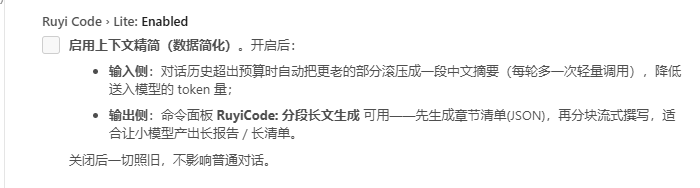
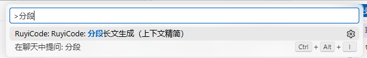
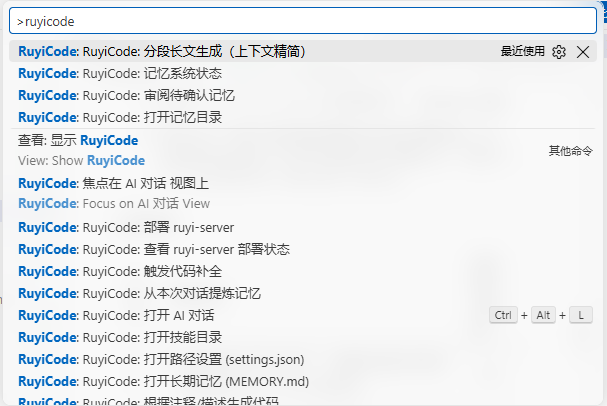
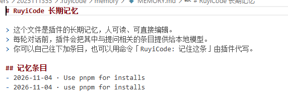
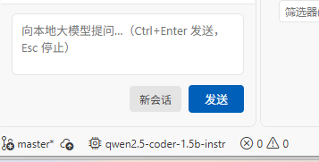

# RuYiCode 0.4.13 插件测试报告

| 项目 | 内容 |
| --- | --- |
| 被测件 | `ruyicode-0.4.13.vsix`（插件标识 `local.ruyi-code`，版本 **0.4.13**） |
| 测试方式 | 在 VS Code 1.145.0 界面上按《RuYiCode 插件完整测试流程》用例操作；本轮做的是记忆系统的审阅环节（G6） |
| 测试人 | ＿＿＿＿＿＿ |
| 测试日期 | 2026-11-04 |
| 已确认缺陷 | **7 条**（G6-1、J4-1、J4-2、G4-1、J4-3、J4-4、J4-5） |


## 一、测试环境

| 项目 | 内容 |
| --- | --- |
| 操作系统 | Windows 11 专业版（10.0.26200） |
| VS Code | 1.145.0，简体中文界面（开始测试时是 1.144.0，中途自动升级了，两版操作结果一致） |
| 插件 | `local.ruyi-code@0.4.13`，装在 `C:\Users\2025111355\.vscode\extensions\local.ruyi-code-0.4.13` |
| 推理引擎 | 本轮没用到。这个缺陷跟模型无关，候选内容是手工写的 |
| 记忆目录 | `C:\Users\2025111355\.ruyicode\memory`（`ruyiCode.memory.dir` 留空，用默认位置） |


## 二、缺陷汇总

| 编号 | 严重程度 | 涉及用例 | 问题概述 |
|---|---|---|---|
| **G6-1**（原 N10） | 一般 | G6 | 记忆候选里选「剩下全部采纳」，实际只采纳了当前这一条，其余三条退回待确认，提示也写着「采纳 1 条」 |
| **J4-1** | 一般 | J4 | 关闭「上下文精简」总开关后，`分段长文生成`命令仍在命令面板里，点下去照样弹出主题输入框，设置项说明与实际行为不一致 |
| **J4-2** | 建议 | J4 | 命令面板里插件自己的命令都显示成「RuyiCode: RuyiCode: …」，前缀重复一次（整屏都是，无一例外） |
| **G4-1** | 建议 | G4 | 「记住这条」的去重区分大小写：同一句 `Use pnpm for installs` 和 `use pnpm for installs` 被当成两条分别写入，而插件写的是"重复内容自动去重" |
| **J4-3** | 一般 | J4 | 分段长文生成开始后只有进度条，**没有取消按钮**，一节一两分钟、默认 4～10 节，中途想停只能重载窗口 |
| **J4-4** | 一般 | J4 | 生成的文档里，**每节正文开头又重复一遍小节标题**（5 节中 3 节如此），`## N. 标题` 下面紧跟一行同名文字 |
| **J4-5** | 建议 | J4 | 提示词里的字段名「标题：」「要点：」**漏进了正文**，用户文档里出现这两个词 |

G6-1 和 G4-1 在 0.4.10 的清单里就记过（原编号分别是 N10、N30），0.4.11 到 0.4.13 三个版本的更新日志都没提到它们。J4-1 和 J4-2 是这次测 0.4.13 新增的上下文精简时碰到的，之前没记过。

## 三、缺陷详情

### G6-1（一般）选「剩下全部采纳」，只采纳了一条

#### 现象

记忆里攒了几条待确认的候选，执行「RuyiCode: 审阅待确认记忆」会一条一条问你怎么处理。四个选项依次是：采纳为长期记忆、丢弃这条、稍后再定、剩下全部采纳。

在第一条候选上直接点最后一个「剩下全部采纳」，右下角弹出来的提示是：

> 审阅完成：采纳 1 条，丢弃/去重 0 条。

只采纳了一条。

接着打开 `MEMORY.md`，确实只多了 1 行（301 字节变成 355 字节）。剩下三条还老老实实躺在 `pending` 那个文件里，内容和顺序都没变。再执行一次「RuyiCode: 记忆系统状态」，待确认从 4 条变成 3 条，没清零。

操作前后的状态截图如下。

操作前，4 条待确认：


点「剩下全部采纳」之后的提示：


操作后，长期记忆 1 条、待确认还剩 3 条：


#### 复现步骤

1. 命令面板执行「RuyiCode: 打开记忆目录」，在打开的目录里把 `MEMORY.md` 复制一份留着，改名 `MEMORY.md.bak`，测完用来还原。
2. 进 `pending` 目录，新建文件 `2026-11-04-1000.md`，内容照下面写（一行标题、一行来源、四条候选），保存。确认 `pending` 里只有这一个 `.md` 文件。

   ```
   # 待确认记忆 · 2026-11-04 10:00

   来源：AI 对话

   - 本项目所有日志前缀用 [ruyi]
   - 部署统一走 RuyiCode: 自动部署并启动 ruyi-server
   - 单测框架用 vitest
   - 提交前必须跑 npm run lint
   ```

   这几行跟插件自己「从本次对话提炼记忆」生成的文件是一样格式的，手工写是为了不连模型也能单独验审阅这一步。

3. 命令面板执行「RuyiCode: 记忆系统状态」，记下当前是 0 条长期记忆、4 条待确认。
4. 命令面板执行「RuyiCode: 审阅待确认记忆」。
5. 弹出的框标题是「记忆候选：本项目所有日志前缀用 [ruyi]」，四个选项，点最后一个「剩下全部采纳」。
6. 看右下角的提示文字。
7. 打开 `MEMORY.md`，数一下多了几条。
8. 回到 `pending\2026-11-04-1000.md`，看文件还在不在、还剩几条。
9. 再执行一次「RuyiCode: 记忆系统状态」，看待确认条数。
10. 测完还原：删掉 `pending\2026-11-04-1000.md`，把 `MEMORY.md.bak` 改名回 `MEMORY.md` 覆盖过去，再执行一次「记忆系统状态」确认回到 0 条记忆。

#### 实测结果

| 步骤 | 实际结果 | 应该是什么结果 |
| --- | --- | --- |
| 5 | 4 条候选都正常列出来了，弹窗标题取的是第一条候选的内容，四个选项都在 | 一样 |
| 6 | 提示「审阅完成：采纳 1 条，丢弃/去重 0 条。」 | 采纳 4 条 |
| 7 | `MEMORY.md` 只多了 1 行：`- 2026-11-04 · 本项目所有日志前缀用 [ruyi]`，文件从 301 字节变成 355 字节 | 多 4 行 |
| 8 | `pending\2026-11-04-1000.md` 还在，候选从 4 条变成 3 条 | 文件应该被删掉 |
| 9 | 变成「1 条长期记忆 · 0 天日志 · 3 条待确认」 | 待确认清零 |

### J4-1（一般）关掉「上下文精简」总开关后，分段长文生成仍然能用

#### 现象

设置里把 `Ruyi Code › Lite: Enabled` 的勾去掉，也就是关掉上下文精简。然后到命令面板搜「分段」，这条命令还在：

> RuyiCode: RuyiCode: 分段长文生成（上下文精简）

没变灰，也没消失。点下去，直接弹出「分段长文生成（JSON 清单驱动）」的主题输入框，说明命令没有被这个开关拦住。

但设置项自己的说明是这么写的：

> 启用上下文精简（数据简化）。**开启后**：
> - 输入侧：对话历史超出预算时自动把更老的部分滚压成一段中文摘要……
> - 输出侧：命令面板 **RuyiCode: 分段长文生成** 可用——先生成章节清单(JSON)，再分块流式撰写……
>
> 关闭后一切照旧，不影响普通对话。

按这段文字看，"命令可用"是开启这个开关之后才有的能力，关掉之后不该还能把任务起起来。实际是开关只管住了输入侧的摘要，没管住输出侧的命令。

图一是设置里已经取消勾选的样子，说明文字也一起截在里面：



图二是关掉之后命令面板里还能搜到这条命令：



图三是点下去之后弹出来的主题输入框：


#### 复现步骤

1. `Ctrl+,` 打开设置，搜索框输入 `lite`。
2. 找到 `Ruyi Code › Lite: Enabled`，把勾去掉（描述里有"上下文精简 / 数据简化"的那一项）。
3. `Ctrl+Shift+P` 打开命令面板，输入 `分段`。
4. 列表里会出现 `RuyiCode: RuyiCode: 分段长文生成（上下文精简）`。
5. 直接点它。

#### 实测结果

| 步骤 | 实际结果 | 应该是什么结果 |
| --- | --- | --- |
| 2 | 勾可以正常取消并保存，关掉设置重开还是未勾选 | 一样 |
| 4 | 命令仍在列表里，没有变灰也没有隐藏 | 应该隐藏，或者点了给出"请先开启上下文精简"的提示 |
| 5 | 弹出了主题输入框，可以继续输入主题 | 应该被拦下来 |

另外提醒一句：这个命令一旦输入主题确认，就会开始生成，流程比较长（先出章节清单，再分节逐段写，默认 4 到 10 节）。开关没拦住的话，本来不想用这个功能的人也可能误触发。

### J4-2（建议）命令面板里命令名重复显示「RuyiCode: RuyiCode:」

#### 现象

命令面板里搜 `ruyicode`，插件自己的命令整屏都是两遍前缀，像这样：

> RuyiCode: RuyiCode: 分段长文生成（上下文精简）
> RuyiCode: RuyiCode: 记忆系统状态
> RuyiCode: RuyiCode: 审阅待确认记忆
> RuyiCode: RuyiCode: 打开 AI 对话

一屏十几条，每条都带两遍，没有例外。看着像插件名写了两遍，容易让人以为装了两个不同的插件。



图里还有个对照：中间那两条 `RuyiCode: 焦点在 AI 对话 视图上`、`RuyiCode: Focus on AI 对话 View` 是单的，只有一遍前缀。这说明重复不是命令面板的问题，是插件自己的命令名里就写了一遍 RuyiCode，命令面板前面又加了分类。

#### 复现步骤

1. `Ctrl+Shift+P` 打开命令面板。
2. 输入 `ruyicode`。
3. 看列表里各条命令的显示文字。

#### 实测结果

一屏能看到的命令全部是两遍前缀；命令本身都能用，只是显示上重复。

### G4-1（建议）「记住这条」去重区分大小写，同一句话会记两条

#### 现象

插件自己是带去重的。同一句话记第二遍，会提示「这条已经记过了，未重复写入。」，文件里也只有一条。

但把同一句话换个大小写再记一次，插件就当成新内容写进去了：

- 第一次输入 `Use pnpm for installs`，提示「已记住：2026-11-04 · Use pnpm for installs」
- 原样再输入一遍，提示「这条已经记过了，未重复写入。」
- 第三遍改成全小写 `use pnpm for installs`，提示又变成「已记住：2026-11-04 · use pnpm for installs」

打开 `MEMORY.md` 一看，里面是两条几乎一样的条目：



下面三张提示截图按顺序是：第一次记、原样再记一次、改大小写再记一次。


插件的更新日志里写的是：

> **「记住这条」**：选中代码后执行命令，或点对话回答下方的按钮，即可把内容写入长期记忆；**重复内容自动去重**。

流程文档 G4 用例也写着"重复内容会自动去重"，命令速查里还标了"（自动去重）"。按这个说法，"只差大小写"应该算同一句话，实际会被当成两条。

#### 复现步骤

1. `Ctrl+Shift+P` → `RuyiCode: 记住这条`，输入 `Use pnpm for installs`，回车。
2. 再执行一次，输入完全相同的内容，回车。这时应该看到「这条已经记过了，未重复写入。」。
3. 第三次执行，输入全小写 `use pnpm for installs`，回车。
4. `Ctrl+Shift+P` → `RuyiCode: 打开长期记忆 (MEMORY.md)`，看文件里有几条。

#### 实测结果

| 步骤 | 实际结果 | 应该是什么结果 |
| --- | --- | --- |
| 2（完全相同） | 提示「这条已经记过了，未重复写入。」，文件里仍 1 条 | 一样，做对照用 |
| 3（只改大小写） | 提示「已记住：2026-11-04 · use pnpm for installs」 | 应该和上一步一样提示"已经记过了" |
| 4 | `MEMORY.md` 里 2 条，内容只差大小写，文件从 301 字节变成 377 字节 | 1 条 |

两条的差别只有大小写，所以问题就出在去重时没忽略大小写。后果是长期记忆会越攒越乱，同一条约定记两遍，每条都占注入预算，等于把 3000 字的记忆预算浪费在同一件事上。

如果产品上认为大小写不同就该算两条，那至少提示语和文档要说明"去重区分大小写"，现在这样用户是不知道的。

### J4-3（一般）分段生成长文一旦开始就没法取消

#### 现象

引擎连上之后，命令面板执行「RuyiCode: 分段长文生成（上下文精简）」，输入主题回车，顶栏就出现「RuyiCode: 分段生成中…」的进度通知。

通知里只有一条进度条在走，**没有取消或停止按钮**。右上角那个叉只是把通知收起来，任务照旧在跑。

生成一节要一两分钟，清单默认 4 到 10 节，也就是要等好几分钟到十几分钟。这段时间里除了重载窗口把扩展杀掉，界面上没有任何办法让它停下来。

图一是托管启动成功之后的状态栏，显示已连上模型：



图二是生成中的进度通知，只有进度条：


#### 复现步骤

1. `Ctrl+,` 搜 `lite`，勾上 `Lite: Enabled`。
2. 点左下角「AI 离线」→ 弹窗里点「尝试托管启动本地引擎」，等状态栏变成模型名。
3. `Ctrl+Shift+P` → `RuyiCode: 分段长文生成（上下文精简）`，输入 `本地大模型部署注意事项`，回车。
4. 看顶栏那个进度通知。

#### 实测结果

| 步骤 | 实际结果 | 应该是什么结果 |
| --- | --- | --- |
| 2 | 托管启动成功，状态栏显示 `qwen2.5-coder-1.5b-instr` | 一样 |
| 4 | 只有进度条，没有取消/停止按钮；点叉只是收起通知，任务继续 | 应该有取消按钮，点了能中途停下，已生成的部分保留 |

另外这个命令没有二次确认，输完主题回车就开跑，一旦开始就停不下来，误触之后只能干等或者强杀窗口。

### J4-4（一般）每节正文开头又重复一遍小节标题

#### 现象

生成出来的文档里，插件拼的小节标题和模型自己写的标题撞在一起。这次 5 节里有 3 节是这样：

> ## 1. 前言
> 前言：
>
> ## 3. 本地大模型部署的代码编写
> 本地大模型部署的代码编写

按 J4 用例的说明，`## N. 标题` 是小节标题，下面才是正文；正文里不该再写一遍同样的标题。

#### 复现步骤

1. 按 J4-3 的步骤生成一篇（主题：`本地大模型部署注意事项`）。
2. 生成结束会自动打开一篇 Markdown 文档。
3. 从上往下看每个 `## N. ` 下面紧跟的第一行是什么。

#### 实测结果

| 小节 | 正文第一行 | 是否重复标题 |
| --- | --- | --- |
| 1. 前言 | `前言：` | 重复 |
| 2. 本地大模型部署的环境准备 | `标题：本地大模型部署的环境准备` | 重复，还多了"标题："两个字 |
| 3. 本地大模型部署的代码编写 | `本地大模型部署的代码编写` | 重复 |
| 4. 本地大模型部署的测试和调试 | `测试和调试是确保本地大模型部署成功的关键步骤……` | 正常 |
| 5. 本地大模型部署的部署和上线 | `### 2. 部署模型到生产环境` | 正常 |

整篇产出已存档，见 `测试数据/J4-分段生成产出-本地大模型部署注意事项.md`（5 个 `##` 小节、8 个 `###` 子小节）。

顺带一个现象，没单列成缺陷：第 5 节的子小节编号是 `### 2.` `### 3.` `### 4.`，**缺了 `### 1.`**，那一节开头的内容没写出来。看着是模型输出不完整，不是拼装的问题，先记在这里。

### J4-5（建议）提示词里的「标题：」「要点：」漏进了正文

#### 现象

第 2 节的正文开头是这样：

> 标题：本地大模型部署的环境准备
>
> 要点：
>
> 1. **选择合适的硬件**：……

`标题：` 和 `要点：` 是插件给模型的结构化提示词里的字段名，模型照着抄进了正文。用户拿到的文档里就莫名多出这两个词。

#### 复现步骤

同 J4-3。生成完看第 2 节的正文开头。

#### 实测结果

第 2 节正文里出现了提示词字段名 `标题：` 和 `要点：`，其余小节没有。正文里不应该出现提示词用词。

## 四、测试记录表

**4.1 引擎测试情况**

| 引擎 | 平台 | 是否测试 | 说明 |
|---|---|---|---|
| llama.cpp | Windows | ☑ 已测 | 插件「尝试托管启动本地引擎」启动成功，端口 8080；`llamaHome` 路径含空格与中文也能起来 |
| Ollama | Windows | ☐ 未测 | 同上 |
| ruyi-server | Windows + WSL | ☐ 未测 | 同上，本机也没部署（缺 ruyi-serving 和 `.rax` 模型） |
| llama.cpp | Linux | ☐ 未测 | 本轮在 Windows 上做 |
| Ollama | Linux | ☐ 未测 | 同上 |
| ruyi-server | Linux | ☐ 未测 | 同上 |

**4.2 测试机配置**

| 项目 | 内容 |
| --- | --- |
| 操作系统 | Windows 11 专业版（10.0.26200） |
| VS Code | 1.145.0 |
| 插件版本 | 0.4.13 |
| 推理引擎 | llama.cpp（b11223 CPU 版），插件托管启动，端口 8080 |
| 模型 | qwen2.5-coder-1.5b-instruct-q4_k_m.gguf（1.04 GB，CPU 推理） |
| 记忆目录 | `C:\Users\2025111355\.ruyicode\memory` |
| 测试前状态 | `MEMORY.md` 301 字节，0 条记忆 |

**4.3 缺陷记录**

| 编号 | 严重程度 | 现象描述 | 复现步骤 | 证据 |
| --- | --- | --- | --- | --- |
| **G6-1**（原 N10） | ☐致命 ☐严重 **☑一般** ☐建议 | 审阅记忆候选时点「剩下全部采纳」，只采纳当前 1 条，其余退回 `pending`；提示写「采纳 1 条」；`MEMORY.md` 只 +1 行，待确认从 4 变 3 没有清零 | ① 备份 `MEMORY.md`<br>② `pending` 下放 4 条候选<br>③ 记忆系统状态记下 4 条待确认<br>④ 审阅待确认记忆，点「剩下全部采纳」<br>⑤ 看提示<br>⑥ 看 `MEMORY.md` 和 `pending` 文件<br>⑦ 再看记忆系统状态 | 截图 3 张：`image/G6-1_1_操作前-待确认4条.png`、`image/G6-1_2_点剩下全部采纳-只采纳1条.png`、`image/G6-1_3_操作后-长期记忆1条待确认3条.png`；`MEMORY.md` 301→355 字节，`pending` 4→3 条 |
| **J4-1** | ☐致命 ☐严重 **☑一般** ☐建议 | 关掉「上下文精简」总开关后，`分段长文生成` 命令仍在命令面板里，点下去仍弹出主题输入框；设置项说明写的是"开启后可用" | ① 设置里取消勾选 `Lite: Enabled`<br>② 命令面板搜「分段」<br>③ 命令仍在<br>④ 点它<br>⑤ 弹出主题输入框 | 截图 3 张：`image/J4-1_1_设置里已关掉Lite开关.png`、`image/J4-1_2_命令面板里命令仍在.png`、`image/J4-1_3_点下去仍弹出主题输入框.png` |
| **J4-2** | ☐致命 ☐严重 ☐一般 **☑建议** | 命令面板里插件自己的命令都显示成「RuyiCode: RuyiCode: …」，前缀重复一次；整屏十几条无一例外，连「打开 AI 对话」这种最常用的也是两遍 | 命令面板输入 `ruyicode`，看列表文字 | 截图：`image/J4-2_1_命令面板里命令名全部重复前缀.png` |
| **G4-1** | ☐致命 ☐严重 ☐一般 **☑建议** | 「记住这条」去重区分大小写：`Use pnpm for installs` 与 `use pnpm for installs` 被当成两条分别写入，`MEMORY.md` 从 301 字节变成 377 字节 | ① 记住这条输入 `Use pnpm for installs`<br>② 原样再记一次（提示已记过）<br>③ 改全小写再记一次<br>④ 打开 `MEMORY.md` 看条数 | 截图 4 张：`image/G4-1_1_第一次记住这条.png`、`image/G4-1_2_完全相同再记一次-提示已记过.png`、`image/G4-1_3_只改大小写-仍提示已记住.png`、`image/G4-1_4_长期记忆里变成两条.png` |
| **J4-3** | ☐致命 ☐严重 **☑一般** ☐建议 | 分段长文生成开始后顶栏只有进度条，没有取消/停止按钮；叉号只收起通知，任务继续跑 | ① 勾上 `Lite: Enabled`<br>② 点状态栏托管启动引擎<br>③ 执行 `分段长文生成` 并输入主题<br>④ 看进度通知有无取消按钮 | 截图 2 张：`image/J4-3_1_托管启动成功状态栏显示模型.png`、`image/J4-3_2_分段生成中-进度通知无取消按钮.png` |
| **J4-4** | ☐致命 ☐严重 **☑一般** ☐建议 | 生成的文档里每节正文开头重复一遍小节标题，5 节中 3 节如此 | ① 生成一篇文档<br>② 看每个 `## N.` 下面紧跟的第一行 | 产出存档：`测试数据/J4-分段生成产出-本地大模型部署注意事项.md`（第 1、2、3 节正文首行与小节标题重复） |
| **J4-5** | ☐致命 ☐严重 ☐一般 **☑建议** | 提示词字段名「标题：」「要点：」漏进第 2 节正文 | 生成一篇，看第 2 节正文开头 | 同 J4-4 的产出存档，第 2 节正文以 `标题：` 开头 |


